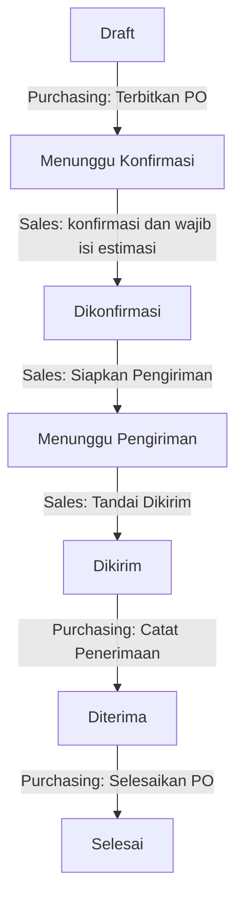

# Workflow V1 Kedai UPU

Implementasi mengikuti `docs/BLUEPRINT.txt`. Web dan Android menggunakan UI JavaScript yang sama, Supabase Auth untuk email/password, PostgreSQL untuk data, dan Capacitor 8 untuk APK.

## Peran

| Tindakan | Purchasing | Sales Supplier | Admin |
|---|---|---|---|
| Membuat / mengedit Draft dan menerbitkan | Ya | Tidak | Ya |
| Melihat PO | Semua di workspace | Supplier tanggung jawabnya; Draft disembunyikan | Semua di workspace |
| Konfirmasi + estimasi antar | Tidak | Ya | Ya, sebagai pengelola |
| Ubah estimasi / siapkan / kirim barang | Tidak | Ya | Ya |
| Catat penerimaan / selesai | Ya | Tidak | Ya |
| Kelola user, supplier, mapping dan produk | Tidak | Tidak | Ya |

Satu supplier memiliki satu Sales aktif. Satu Sales dapat menangani beberapa supplier. Mengganti mapping mengalihkan akses seluruh PO supplier kepada Sales baru; penugasan PO aktif dicatat dan Sales baru diberi notifikasi. Supplier dengan PO aktif tidak boleh kehilangan mapping atau dinonaktifkan. User dengan mapping supplier aktif tidak dapat dinonaktifkan sebelum mapping dipindahkan.

## Status dan penanggung jawab

Penerbitan mensyaratkan supplier aktif dengan mapping Sales aktif. Status tidak dapat dilompati atau dimundurkan. Estimasi dapat diperbarui oleh Sales selama Dikonfirmasi / Menunggu Pengiriman / Dikirim, dengan riwayat perubahan. Terlambat dihitung bila estimasi sudah lewat dan barang belum diterima.

Nomor PO unik dibuat server. Tanggal penomoran menggunakan Asia/Jakarta. Barang menyimpan nama dan satuan saat PO dibuat; perubahan master tidak mengubah barang pada PO lama.

## Notifikasi dan timeline

PO diterbitkan: notifikasi untuk Sales yang dipetakan. Konfirmasi dan progres berikutnya: notifikasi bagi Purchasing/Admin lain. Notifikasi V1 berada di dalam aplikasi, diperiksa setiap 15 detik saat aplikasi terbuka. Belum ada push notification, email otomatis, atau WhatsApp.

Timeline mencatat aktor, waktu server, dan peristiwa. Pembukaan PO pertama oleh setiap Sales dicatat satu kali. Client tidak dapat mengedit timeline langsung. Semua perubahan memakai RPC dengan validasi role dan versi PO, bukan penggantian seluruh database.

## Database dan keamanan

- `po_users`, `po_suppliers`, `po_products`, `po_orders`, `po_items`, `po_timeline`, `po_notifications`.
- RLS membatasi SELECT langsung dan respons dashboard per workspace/supplier. Tidak ada hak tulis langsung untuk browser.
- `po_command` menjalankan tindakan, timeline, dan notifikasi dalam transaksi. Lock workspace mencegah mapping/role berubah bersamaan dengan penerbitan atau konfirmasi. Versi per PO menolak formulir lama.
- Request ID melindungi pembuatan PO dan impor dari duplikasi saat respons jaringan terputus. Impor semua supplier bersifat atomik, maksimal 100 supplier / 10.000 baris / 5 MB file.
- Akses akun Auth tidak otomatis memberi peran. Admin mendaftarkan akun yang sudah dibuat di Supabase Authentication, tanpa memasukkan password di aplikasi.
- Backup JSON V2 merupakan ekspor data yang boleh dilihat akun tersebut, bukan alat menimpa seluruh database. Pemulihan dan pengubahan audit dilakukan pengelola database, bukan Sales.

## Mengaktifkan pada proyek Supabase yang sudah ada

1. Unduh cadangan aplikasi lama. Pastikan akun pengelola sudah dibuat di Authentication > Users dan email terkonfirmasi.
2. Jalankan migrasi `supabase/migrations/202610260002_workflow.sql` satu kali setelah migrasi pertama. Jangan menjalankan ulang pada database yang sudah memiliki tabel `po_*`.
3. Berikan peran Admin pertama melalui SQL Editor sebagai pemilik proyek. Pada workspace ini tersedia skrip lokal `.openai/activate-blueprint.sql` yang menggabungkan migrasi dan bootstrap email pengelola dalam satu transaksi. Gunakan skrip gabungan itu sebagai pengganti langkah 2 dan 3, bukan menjalankan keduanya.
4. Refresh web / buka ulang Android. Bootstrap mendeteksi skema baru dan memuat UI V2. Sebelum migrasi tersedia, UI lama tetap digunakan. Kegagalan jaringan tidak mengalihkan ke data lokal.
5. Admin membuat akun Auth untuk Purchasing dan Sales di dashboard Supabase, lalu mendaftarkan perannya melalui menu User aplikasi.
6. Admin memetakan Supplier → Sales. Purchasing membuat dan menerbitkan PO. Sales masuk dari perangkat lain untuk konfirmasi dan mengisi estimasi.

Migrasi mempertahankan dokumen JSON lama sebagai arsip, menyalin supplier, produk dan PO ke tabel baru, serta menutup API dokumen bersama agar tidak menjadi jalur bagi Sales untuk melihat supplier lain. Status lama: Draft→Draft, Sent→Menunggu Konfirmasi, Confirmed→Dikonfirmasi, Delivered→Selesai. Mapping Sales harus diisi Admin. Identitas konfirmasi dan waktu historis tidak dikarang; timeline menandai data yang diimpor. Anggota lama diberi role Purchasing; bootstrap terpisah diperlukan untuk Admin pertama.

## Struktur proyek dan validasi

- `dist/bootstrap.js`: pemilihan skema/UI.
- `dist/workflow.js`: halaman dan interaksi role.
- `dist/workflow-model.js`: label status, aksi UI, validasi barang dan keterlambatan.
- `src/native.js` → `dist/native.js`: ekspor native, tombol kembali dan refresh saat Android aktif.
- `android/`: proyek Android Capacitor.
- `tests/workflow-database.test.cjs`: transisi, RLS, isolasi supplier, konflik, notifikasi, idempotensi dan impor atomik.
- `tests/workflow-browser.cjs`: lima skenario browser nyata pada viewport HP, dengan API mock; tidak mengubah data produksi.

Pengujian PostgreSQL menggunakan PGlite. Pengujian ini tidak menggantikan pemeriksaan dua akun sungguhan setelah migrasi produksi dijalankan. UI mengambil seluruh data yang diizinkan role untuk V1 tim kecil; pagination dan push dapat ditambahkan bila volume meningkat.